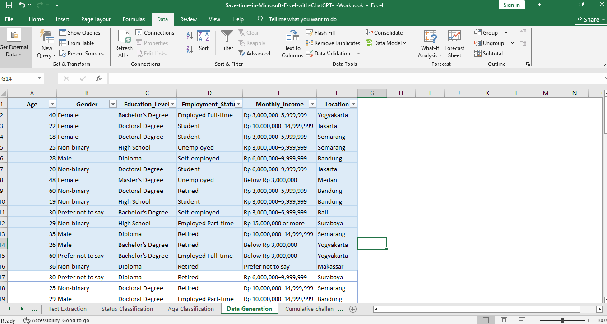
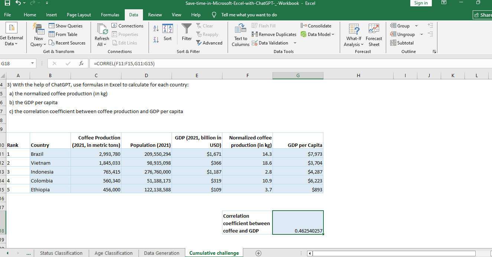

# Save Time in Microsoft Excel with ChatGPT (AI)

## Project Overview

This project demonstrates how ChatGPT can assist with everyday Microsoft Excel tasks, making data cleaning, standardisation, text extraction, classification, and data analysis more efficient.

The workbook contains eight practical exercises combining Excel formulas with AI-assisted problem-solving.

## Project Objectives

- Improve productivity when working with Excel.
- Standardise inconsistent data formats.
- Extract structured information from URLs and text.
- Classify data using Excel formulas.
- Generate dummy datasets with AI assistance.
- Perform calculations and basic statistical analysis.

## Exercises and Analysis Results

### 1. Date and Category Standardisation

Standardised inconsistent date formats and categorical values such as Yes, No, and Unknown.

### 2. URL Extraction

Extracted root URLs and estimated page titles into separate columns.

### 3. Structured Text Extraction

Split equipment identification codes into Version, Model Number, and Item Number.

### 4. Status and Age Classification

Applied classification techniques to organise records into meaningful groups.

### 5. Dummy Data Generation

Explored how ChatGPT can assist with generating sample datasets for Excel exercises.

### 6. Cumulative Challenge – Coffee Production Analysis

Analysed coffee production, population, and GDP per capita for five coffee-producing countries in 2021.

Calculated:
- Normalised coffee production per capita (kg).
- GDP per capita (USD).
- Correlation coefficient between coffee production per capita and GDP per capita.

**Correlation coefficient:** 0.463

The result indicates a moderate positive correlation within this five-country sample. It does not establish causation.

## Tools and Technologies

- Microsoft Excel
- ChatGPT (AI)
- Excel formulas: IF, OR, TEXT, CORREL
- Data Cleaning and Standardisation
- Data Extraction and Classification
- Basic Statistical Analysis

## Project Files

- Excel workbook containing the exercises and results.
